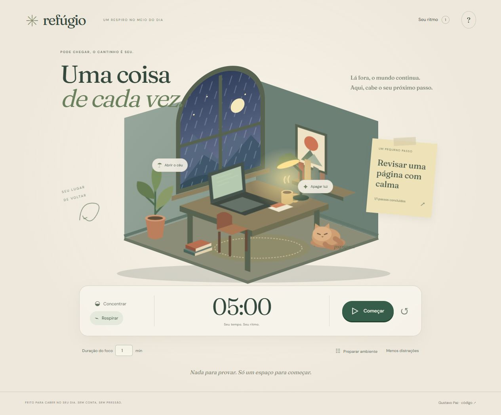

# Refúgio

**Uma coisa de cada vez.** Um cantinho ilustrado para escolher um próximo passo, ajustar o ambiente e começar um ciclo de concentração.

[Entre no seu Refúgio](https://gustapaz.github.io/refugio/)



## O que dá para fazer

- Preparar a sala: manhã, entardecer ou noite; luminária e chuva independentes.
- Escolher entre foco de 1 a 90 minutos e pausa de cinco minutos.
- Iniciar, pausar, retomar ou reiniciar com confirmação quando há tempo em andamento.
- Escrever até 12 pequenos passos, escolher uma intenção e marcar conclusões.
- Guardar até 100 ciclos concluídos, com intenção e duração; exportar um registro TXT.
- Ligar três texturas sonoras sintetizadas, regular volume e desligar quando quiser.
- Reduzir distrações ou desativar o movimento do ambiente. Carinho no gato é bem-vindo.

## Stack e execução

Nuxt 4 + Vue 3 + TypeScript, SVG autoral, CSS e Web Audio API. Fontes locais DM Sans e Fraunces.

```sh
npm ci
npm run dev
npm test
npm run check
npm run typecheck
npm run build
npm run preview
```

Node.js 24. Aplicação em `/refugio/`, preview em `http://127.0.0.1:5192/refugio/`. `nuxt generate` pré-renderiza o conteúdo e gera arquivos estáticos em `.output/public`. Apenas essa pasta é publicada no GitHub Pages pelo workflow; não há servidor em produção.

## Dados, tempo e privacidade

Cenário e conteúdo inicial demonstrativos. Tarefas e estatísticas começam vazias e usam apenas ações reais da pessoa. Sem conta, API de aplicação, banco, IA, pagamentos ou analytics. Tudo fica no localStorage deste navegador, sem sincronização. O TXT é um relatório, não um backup importável. Limpar os dados do site remove o registro.

O timer usa um prazo absoluto no relógio do dispositivo, inclusive quando a aba está em segundo plano ou é recarregada. Uma conclusão é registrada uma única vez; ele não inicia outro ciclo sozinho. **Tempo decorrido não é uma medição de atenção ou produtividade.** Mudanças no relógio do sistema podem afetar o timer. Não há notificações, alarme obrigatório ou perda de progresso por pausar.

Áudio começa desligado, depende de um clique e é sintetizado localmente; não há gravações, microfone ou streaming. Ao sair da aba, o áudio é suspenso. A chuva na ilustração e a textura sonora são controles separados. As três texturas são estilizações de ruído, não gravações reais de chuva, vento e água.

## Design e qualidade

Uma sala em perspectiva oblíqua, papel de intenção ao lado e dock de tempo abaixo. Tons de papel, madeira e sálvia, com letras serifadas. A composição difere do observatório escuro do Órbita, da trilha do CodePop e dos painéis de trabalhos anteriores. Não reutiliza os shells ou CSS dessas entregas.

[Decisões de design](docs/design.md) · [Testes e revisão](docs/validacao.md)

## Licenças e referências

Código, ilustração, animações e síntese de áudio: MIT, Gustavo Paz. DM Sans e Fraunces: SIL Open Font License, preservada em `docs/`. Nuxt e Vue mantêm suas licenças MIT. Referências técnicas: [Nuxt — publicação estática](https://github.com/nuxt/nuxt/blob/main/docs/1.getting-started/16.deployment.md) e [MDN — Web Audio](https://developer.mozilla.org/en-US/docs/Web/API/Web_Audio_API/Using_Web_Audio_API).

Hospedagem e dependências gratuitas, sem cartão, faturamento ou trial.

A auditoria de dependências e os avisos baixos restantes na cadeia de build estão descritos em [docs/validacao.md](docs/validacao.md#dependências).
